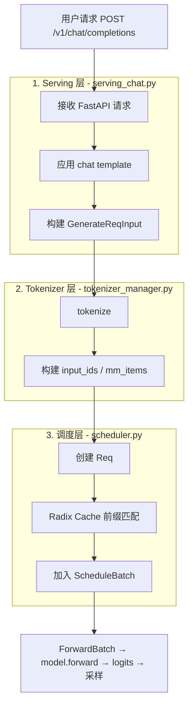
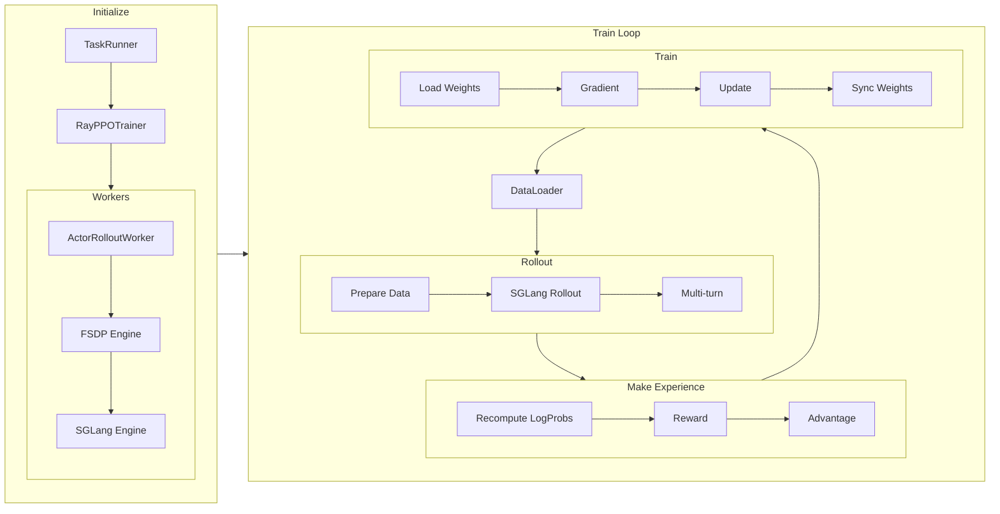
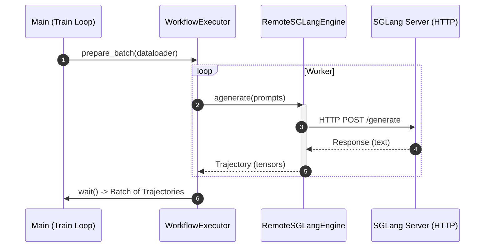
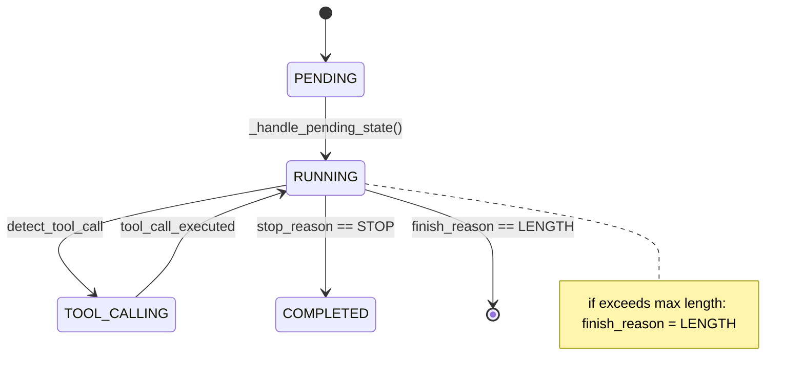

# Data-flow diagrams in mermaid

Author diagrams mermaid-first: an LLM can emit mermaid directly, it renders on GitHub, and
it diffs cleanly. (The repo's *polished* docs mostly ship static images — but many of those
are just rendered mermaid whose source was never committed, e.g. `sglang-omni/mermaid-redraw/`.
If you replace a mermaid block with a rendered/styled image, keep the mermaid source as an
unrendered appendix — `## 附录：流程图 Mermaid 源码`, the convention in
`sglang/code-walk-through/multimodal_request_lifecycle.md`.) **Never use ASCII art**
(`┌┐└┘│├─`) — it breaks across devices. Comparisons go in tables, linear paths in numbered
lists, and only true graphs/sequences/state-machines become diagrams.

## Pick the diagram type by job

| job | mermaid type |
|---|---|
| component / data-flow overview (who passes what to whom) | `flowchart`/`graph` with subgraphs |
| cross-component call + data exchange over time, async, threads | `sequenceDiagram` |
| one object/structure moving through states | `stateDiagram-v2` |
| a structure's memory layout before/after an allocation | two small `flowchart`s, or a table |

A typical walk-through has one overview `flowchart` near the top, plus targeted diagrams per
section. Put the diagram *first* in its section and let the prose be step-by-step commentary
on it ("我们顺着图里的步骤走一遍").

## Convention 1 — staged data flow (`graph TD` + numbered subgraphs)

Group each pipeline stage into a `subgraph` labeled `<number>. <stage name> - <file.py>`, so
the diagram doubles as a table of contents that maps stages to source files. Nodes are
double-quoted strings; connect a stage's exit node to the next stage's entry node *outside*
both subgraphs. Adapted from the multimodal request lifecycle:



When data structures matter more than files, name the structure on the edge (see Convention
4) or make nodes the structures themselves.

## Convention 2 — nested phases for a training loop (`flowchart LR`)

For a step that cycles (rollout → make-experience → train → sync → repeat), use `flowchart LR`
with one subgraph per phase and an edge that closes the loop. Adapted from verl:



`direction TB` inside an `LR` graph stacks a subgraph's internals vertically while phases
flow left-to-right — this keeps wide pipelines readable.

## Convention 3 — async / cross-process exchange (`sequenceDiagram`)

When timing, threads, or request/response across a process boundary is the point, use
`sequenceDiagram` with `autonumber`, explicit `loop` blocks for background threads, and
`activate`/`deactivate` bars to show who holds the call. Label arrows with the call and the
data returned. Adapted from AReaL:



Use solid `->>` for calls, dashed `-->>` for returns. The returned-data label (`Trajectory
(tensors)`) is where you show what crosses the boundary.

## Convention 4 — object state machine (`stateDiagram-v2`)

For a structure that is fundamentally a state machine (a multi-turn rollout request, a
request's prefill→decode→finished progression), draw the states and label transitions with
the function/condition that fires them. Adapted from verl's tool-calling loop:



Transition labels are the *functions or conditions* that drive the change — this ties the
diagram back to the lifecycle-tracing prose.

## Edge labels = the data that moves

In a data-flow diagram, prefer edges that name the payload, so the picture itself answers
"what flows here": `Scheduler -->|ModelWorkerBatch| TpModelWorker`,
`FSDP -->|named_tensors| SGLang`, `Rollout -->|list[Sample]| Buffer`. An overview where every
edge is labeled with the structure crossing it is the strongest single artifact in the
article.

## When mermaid isn't enough: drawn plots

For a polished "hero" architecture diagram beyond mermaid's layout — nested containers with
semantic color tiers, ①-numbered data paths with a payload legend, ×N replica stacks,
CPU–GPU timelines — **author an Excalidraw plot yourself**: generate the `.excalidraw`
scene, render it via kroki, self-check the render, and commit source + export. Full method,
visual grammar, and element builders: `excalidraw-plots.md` (+ `templates/excalidraw_kit.py`).
The repo precedents are `sglang/code-walk-through/sglang_scheduler.svg` and
`rlhf/verl/multi-turn/imgs/agentLoop.png` (both Excalidraw). Default to mermaid; reach for
a drawn plot only for the one or two figures whose layout carries meaning mermaid can't
express. To rasterize *mermaid* locally if a static asset is wanted:
`npx -p @mermaid-js/mermaid-cli mmdc -i diagram.mmd -o diagram.svg`.

Embed any rendered figure centered, always with alt text:

```html
<div style="text-align: center; width: 100%; margin: 0 auto;">
     整体架构" style="width: 100%; height: auto;">
</div>
```

(Or `<div align="center"></div>` for a smaller
figure.)

## Pitfalls

- **One mega-diagram.** Split: one overview + per-section zoom-ins beats a 40-node wall.
- **Unlabeled edges in a data-flow graph.** If the article is about data flow, the edges
  should say what flows.
- **Diagram that contradicts the prose.** Generate the diagram from the same lifecycle trace
  you wrote; re-check node/function names against the pinned source.
- **Mermaid syntax that won't render.** Keep node text in double quotes when it contains
  punctuation/parentheses/CJK; avoid raw `<`/`>`/`#` inside labels.
