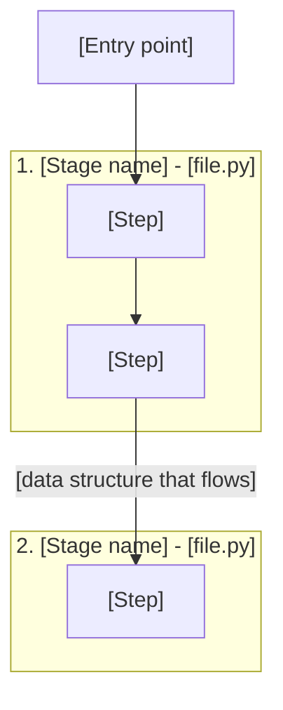
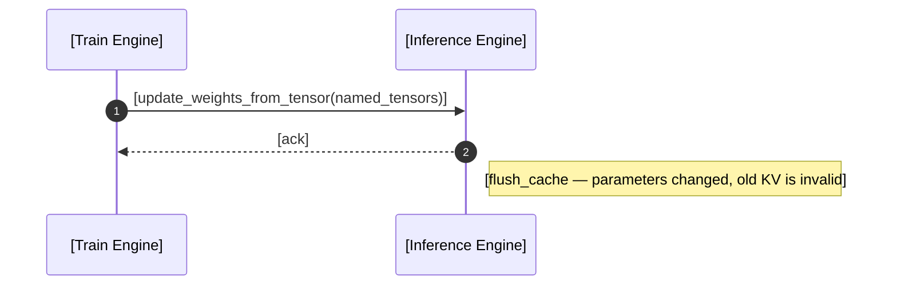

<!--
SKELETON for an ML-sys code walk-through (Awesome-ML-SYS-Tutorial style, technical-structural voice).
Copy this, fill the [brackets], delete the HTML comments. English prose; all figure text
is English-only. Figures are drawn Excalidraw plots rendered to svg/png BY DEFAULT —
mermaid only if the user explicitly asks. Pin ONE commit; every function `###` heading is
a permalink to it. Order is HARD: concept → model/scenario → code. See
../references/*.md for each part. When readme.md is final, IF the user asked in Chinese
or mixed Chinese-English, fan out a subagent to write the Chinese mirror readme-CN.md
(strict mirror, SAME figure files — see ../references/narrative-and-format.md §Language);
skip the mirror for English-only requests.
-->

# [Framework] [Subsystem] Code Walk-through

<!-- LEAD (replaces personal motivation): driving question + ≤4-item roadmap. No anecdotes, no acknowledgements. -->
This article answers one question: **[driving question, e.g.: how does a token's KV cache get allocated, used, and freed across prefill and decode?]**

Roadmap:

1. [Concept frame: what the subsystem is, its core mechanism and constraints]
2. [Key data structures: the 3–6 structures this article traces]
3. [Lifecycle: function-by-function tracing of structure mutations, in execution order]
4. [Optional: cross-component / design trade-offs / comparisons]

## Core Architecture (Concept Frame)

<!-- Concept frame FIRST. Mechanism + constraints, derived progressively. Then the overview diagram. -->
[One paragraph on the subsystem's responsibility and how its components collaborate, motivated by the design problem.]

<!-- OVERVIEW figure (DEFAULT: drawn plot): author an Excalidraw plot — nested containers /
     semantic color tiers / ①-numbered paths + legend / ×N replica stacks as needed (see
     ../references/excalidraw-plots.md), commit images/<fig>.excalidraw + .svg, embed
     centered with alt text, then walk the numbered steps in prose. Use the mermaid block
     below ONLY if the user explicitly asked for mermaid. -->
<!-- Mermaid alternative (explicit request only). Label edges with the data that crosses them. English labels only.

-->

### End-to-End Flow (the Spine)

<!-- ONE numbered list: <component> <function> <data-structure transition> per hop. This is the spine. -->
Concretely, a [request / training step] is processed as follows:

1. [Component] calls [`function`], [transforming structure X into / writing structure Y]
2. ...

## Key Data Structures

<!-- 3–6 protagonists. For each: purpose line + Shape/Access bullets (or dataclass) + a concrete number.
     Name the shared key that cross-links them. See ../references/data-structures.md -->
#### `[Structure1]`
[One-line purpose.]
- **Shape:** [dimensions, what each dimension means]
- **Access:**
  - Dim0: [what the index means]
  - Dim1: [what the index means]
  - Value: [what is stored]

> Example: [instantiate with real numbers, e.g. max-running-requests=4096, context_len=8192 → `[4096, 8192]`].

<!-- The cross-linking sentence: -->
`[Structure1]` and `[Structure2]` are cross-mapped through `[shared key / index]`: [how it stitches them together].

## [Stage One Name]

<!-- One ## per component/phase, English title. Inside: concept then code. -->
### [Concept]
[The mental model for this stage. The transition sentence must cite a specific conclusion from the previous section — not "with these foundations in place".]

### [`function_name`](https://github.com/[org]/[repo]/blob/[commit]/[path]#L[a]-L[b])

<!-- Source+purpose sentence, then code (long bodies in <details>), then numbered analysis. -->
The source is in [`[file.py]`](https://github.com/[org]/[repo]/blob/[commit]/[path]#L[a]-L[b]):

```python
[real code excerpt from the pinned commit]
```

Step-by-step analysis:

1. [What the first step does → which structure it **Allocates/Writes/Updates/Frees**]
2. ...

##### Step 1. Function `[fn]`
- `[StructureA]`: **[Allocate/Write/Update/No change/Free]** [with concrete numbers]
- `[StructureB]`: **[verb]** [...]

<!-- Sibling functions? Use a comparison table; bold the divergence. -->
| Step | `[fn_a]` | `[fn_b]` |
|------|----------|----------|
| 1. [op] | - | - |
| 2. [op] | **[write/update]** | **[free]** |

## [Cross-Component: Optional] (Weight Sync / Rollout→Train)

<!-- If lifecycle spans processes: cover all three levels. See ../references/lifecycle-tracing.md -->
1. **Architecture**: [who gathers, who sends, who receives]
2. **The data structure crossing the boundary**: [`named_tensors` / `DataProto` / `Sample` ... + how it is reshaped for the receiver's parallel layout]
3. **The side effects that must follow**: [flush cache / version bump / lock / pause-resume — and why]

<!-- Cross-component figure: DEFAULT is a drawn Excalidraw sequence/timeline plot
     (../references/excalidraw-plots.md). The mermaid below is the explicit-request alternative.

-->

## References

- [Related articles in the repo](../[path]/readme.md)
- [External resource]([URL])

<!-- SELF-CHECK before finishing — run the checklist in ../references/narrative-and-format.md.
     Then, IF the user asked in Chinese or mixed Chinese-English, fan out the readme-CN.md
     mirror subagent; skip it for English-only requests. -->
