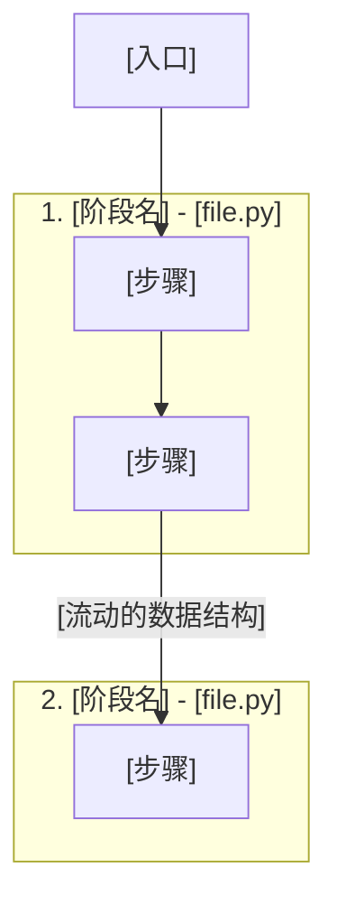
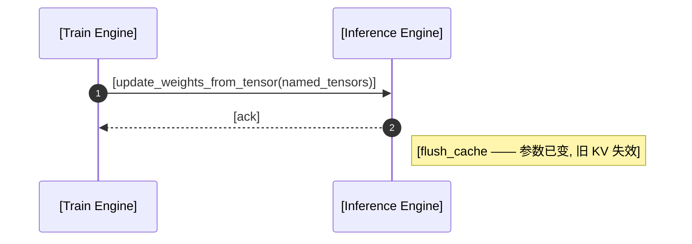

<!--
SKELETON for an ML-sys code walk-through (Awesome-ML-SYS-Tutorial style, technical-structural voice).
Copy this, fill the [brackets], delete the HTML comments. Chinese-first prose; keep technical
terms in English. Pin ONE commit; every function `###` heading is a permalink to it.
Order is HARD: concept → model/scenario → code. See ../references/*.md for each part.
-->

# [框架] [子系统] 代码解析

<!-- LEAD (replaces personal motivation): driving question + ≤4-item roadmap. No anecdotes, no acknowledgements. -->
本文回答一个问题：**[驱动问题，例如：一个 token 的 KV cache 如何在 prefill 与 decode 中被分配、使用、释放？]**

本文的路线：

1. [概念框架：子系统是什么、核心机制与约束]
2. [关键数据结构：本文追踪的 3–6 个结构]
3. [生命周期：按执行顺序，逐个函数追踪数据结构的变化]
4. [可选：跨组件 / 设计权衡 / 对比]

## 核心架构（概念框架）

<!-- Concept frame FIRST. Mechanism + constraints, derived progressively. Then the overview diagram. -->
[一段话概述子系统职责与各组件协作关系，从设计动机出发。]

<!-- HERO figure (optional, ≤1-2 per article): if the overview needs nested containers /
     semantic color tiers / ①-numbered paths + legend / ×N replica stacks, draw it as an
     Excalidraw plot instead (see ../references/excalidraw-plots.md), commit
     images/<fig>.excalidraw + .svg, embed centered with alt text, then walk the numbered
     steps in prose. Otherwise: -->
<!-- Overview data-flow diagram (mermaid). Label edges with the data that crosses them. -->


### 端到端流程（spine）

<!-- ONE numbered list: <component> <function> <data-structure transition> per hop. This is the spine. -->
具体而言，[请求 / 训练步] 的处理过程如下：

1. [组件] 调用 [`function`]，[把结构 X 转成 / 写入 结构 Y]
2. ...

## 关键数据结构

<!-- 3–6 protagonists. For each: purpose line + Shape/Access bullets (or dataclass) + a concrete number.
     Name the shared key that cross-links them. See ../references/data-structures.md -->
#### `[结构1]`
[一句话用途。]
- **形状（Shape）：** [维度，每维含义]
- **访问（Access）：**
  - Dim0: [索引含义]
  - Dim1: [索引含义]
  - 返回值：[存储内容]

> 例子：[用真实数字实例化，例如 max-running-requests=4096, context_len=8192 → `[4096, 8192]`]。

<!-- The cross-linking sentence: -->
`[结构1]`、`[结构2]` 之间通过 `[共享键 / 索引]` 相互映射：[说明它如何串起来]。

## [阶段一名称]（[Stage One Name]）

<!-- One ## per component/phase, bilingual title. Inside: concept then code. -->
### [概念]
[这一阶段的理解框架。过渡句要引用上一节的具体结论，不要用"有了这些基础"。]

### [`function_name`](https://github.com/[org]/[repo]/blob/[commit]/[path]#L[a]-L[b])

<!-- Source+purpose sentence, then code (long bodies in <details>), then numbered analysis. -->
对应源码在 [`[file.py]`](https://github.com/[org]/[repo]/blob/[commit]/[path]#L[a]-L[b])：

```python
[来自 pinned commit 的真实代码片段]
```

逐步分析：

1. [第一步做了什么 → 对哪个结构 **Allocate/Write/Update/Free**]
2. ...

##### Step 1. Function `[fn]`
- `[结构A]`：**[Allocate/Write/Update/No change/Free]** [带具体数字的说明]
- `[结构B]`：**[verb]** [...]

<!-- Sibling functions? Use a comparison table; bold the divergence. -->
| 步骤 | `[fn_a]` | `[fn_b]` |
|------|----------|----------|
| 1. [op] | - | - |
| 2. [op] | **[写入/更新]** | **[释放]** |

## [跨组件：可选]（权重同步 / rollout→train）

<!-- If lifecycle spans processes: cover all three levels. See ../references/lifecycle-tracing.md -->
1. **架构**：[谁 gather、谁发送、谁接收]
2. **跨边界的数据结构**：[`named_tensors` / `DataProto` / `Sample` ... + 如何重排为接收方的并行布局]
3. **必须随之发生的副作用**：[flush cache / 版本号 / 锁 / pause-resume —— 并解释为什么]



## 参考

- [repo 内相关文章](../[path]/readme.md)
- [外部资源]([URL])

<!-- SELF-CHECK before finishing — run the checklist in ../references/narrative-and-format.md -->
